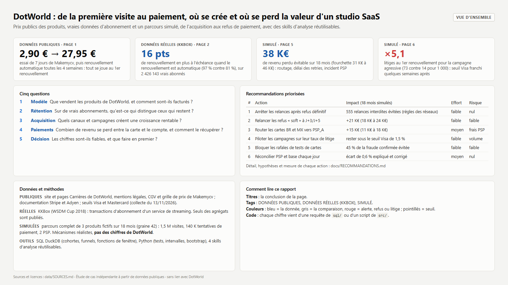

# DotWorld : de la première visite au paiement, où se crée et où se perd la valeur d'un studio SaaS

> **English summary.** Independent Data Analyst case study on DotWorld, a Swiss venture builder and SaaS studio
> that runs several subscription products worldwide. It combines (1) public, sourced facts about the company and the
> public pricing of its proven product (Makemycv: €2.90 7-day trial, then €27.95 every 4 weeks), (2) real subscription
> data (KKBox, WSDM Cup 2018) for cohorts, renewal and voluntary vs involuntary churn, and (3) a labelled, simulated
> end-to-end journey (seed 42) covering acquisition and LTV by channel, funnel and retention, payment acceptance and
> retries by PSP, disputes vs Visa/Mastercard thresholds, fraud, revenue reconciliation and an A/B test readout.
> It ships four reusable analysis "skills" (SKILL.md + parameterised SQL + consistency checks) so teams can answer their
> own questions. Deliverables: a 10-page French PDF report, an HTML dashboard, commented DuckDB SQL and METRICS.md.
> Simulated figures illustrate a method; they are not DotWorld's numbers.

Étude de cas indépendante, à partir de données publiques, sans lien avec DotWorld.

- **Rapport PDF (11 pages)** : [`docs/DotWorld_EtudeDeCas.pdf`](docs/DotWorld_EtudeDeCas.pdf)
- **Tableau de bord** : [`docs/tableau_de_bord.html`](docs/tableau_de_bord.html)
  (en ligne : https://albt-france.github.io/dotworld-saas-analytics-case-study/tableau_de_bord.html)
- **Skills d'analyse** : [`skills/`](skills/README.md) · **Définitions** : [`METRICS.md`](METRICS.md) ·
  **Recommandations** : [`docs/RECOMMANDATIONS.md`](docs/RECOMMANDATIONS.md)



## Résultats clés
| | Résultat | Données |
|---|---|---|
| 1 | Makemycv, le produit de DotWorld identifié avec preuve, fait entrer à **2,90 €** (essai 7 jours) puis renouvelle à **27,95 € toutes les 4 semaines** : 366,25 € la première année en mensuel contre 94,80 € en annuel. Tout se joue au premier renouvellement. | DONNÉES PUBLIQUES |
| 2 | Sur 2,4 millions de vrais abonnés (23 millions de transactions), **97 %** des échéances en renouvellement automatique sont renouvelées dans les 30 jours, contre **81 %** sans ; churn de mars 2017 : **5 % contre 43 %**. 80 % des départs récents sont des formules manuelles simplement non repayées. | DONNÉES RÉELLES (KKBOX) |
| 3 | **38 K€ de revenu perdu évitable** sur 18 mois (31 à 46 K€) : router le Brésil et le Mexique vers l'autre PSP (+9 à +10 pts d'acceptation), relancer les refus « soft » à J+5 plutôt que le jour même (6 % → 17 % de succès), traiter un incident PSP en Espagne. | SIMULÉ |
| 4 | Une **campagne agressive** a le 2e meilleur ROAS mais **5 fois plus de litiges** au premier renouvellement : le compte marchand principal passe au-dessus du nouveau seuil Visa de 1,5 % quelques semaines plus tard. | SIMULÉ |
| 5 | **TikTok** a le coût par visite le plus bas mais le CAC le plus élevé (48 €) ; Google Ads rapporte 3,4 € par euro à 180 jours. | SIMULÉ |

## Questions et réponses
1. **Que vendent les produits de DotWorld, et comment sont-ils facturés ?** Des abonnements à petit prix d'entrée :
   essai payant court, renouvellement automatique toutes les 4 semaines, option annuelle, paiement par carte et Google Pay
   via Stripe, 34 versions localisées (page 1).
2. **Qu'est-ce qui distingue les abonnés qui restent ?** Sur KKBox : le mode de paiement avant tout (renouvellement
   automatique : 5 % de churn, paiement manuel : 43 %) ; la plupart des départs sont des abonnés qui ne repaient pas,
   pas des annulations (page 2). Sur le parcours simulé, où les refus de paiement sont visibles : chez les abonnés de
   4 cycles et plus, 4 départs sur 10 sont involontaires (page 4).
3. **Quels canaux créent une croissance rentable ?** La LTV par payant varie peu d'un canal à l'autre ; c'est le CAC qui
   fait la différence. Google Ads et l'affiliation sont rentables à 180 jours ; TikTok et Meta prospection sont à plafonner (page 3).
4. **Combien de revenu se perd entre la carte et le compte ?** 38 K€ récupérables sur 18 mois simulés, plus 555 relances
   interdites après refus définitif à arrêter (page 5) ; un risque de dépassement des seuils de litiges (page 6).
5. **Les chiffres sont-ils fiables ?** Les deux sources de revenu divergent de 0,63 % ; quatre causes expliquent 98 % de
   l'écart (page 7). Le test « prix transparent » coûte des essais mais pas de revenu ; l'effet sur les litiges reste à prouver (page 8).

## Les skills et comment les utiliser
Quatre dossiers dans [`skills/`](skills/README.md), chacun avec un `SKILL.md` (quand l'utiliser, définitions, étapes,
pièges), des modèles SQL paramétrables, un `run.py` qui lance des **contrôles de cohérence** avant de répondre, et un
`example.md` (question → réponse vérifiée).

| Skill | Exemple |
|---|---|
| `cohort-retention` | `python skills/cohort-retention/run.py --products A B C --grain quarter` |
| `ltv-by-channel` | `python skills/ltv-by-channel/run.py --horizon 180 --dim canal` |
| `payment-health` | `python skills/payment-health/run.py --countries ES --split 2026-04-01 --dim psp` |
| `experiment-readout` | `python skills/experiment-readout/run.py --experiment EXP-A-PRIX-TRANSPARENT --window 60` |

Ils s'utilisent en ligne de commande ou avec un assistant IA qui lit le `SKILL.md`, lance `run.py` et ne répond
qu'après les contrôles. Brancher les vues de [`sql/00_views.sql`](sql/00_views.sql) sur l'entrepôt réel suffit à les
utiliser sur de vraies données.

## Méthodes
- **SQL (DuckDB)**, commenté, dans [`sql/`](sql/) : cohortes sans biais de censure, funnels, fonctions de fenêtre
  (`LAG`, `FIRST_VALUE`, `ROW_NUMBER`), rapprochement ligne à ligne de deux sources.
- **Python** ([`src/`](src/)) : simulation (graine 42), tests de proportions, intervalles de confiance (Wald, bootstrap),
  test de déséquilibre d'échantillon (khi-deux), puissance et effet minimal détectable, chiffrage avec fourchettes.
- **Rapport** : HTML et graphiques SVG générés par [`src/build_report.py`](src/build_report.py), imprimés en PDF par Edge sans interface.
- **Note sur l'IA** : Méthode assistée par l'IA : j'ai utilisé Claude, surtout pour écrire les scripts plus vite. J'ai piloté le projet : j'ai défini les questions, choisi et vérifié les sources de données, pris les décisions d'analyse et contrôlé chaque résultat.

## Définitions
Toutes dans [`METRICS.md`](METRICS.md), avec le SQL et les cas limites : conversion, CAC, ARPA, LTV, rétention,
churn volontaire et involontaire, taux d'acceptation, succès des nouvelles tentatives, taux de litiges (Visa et
Mastercard), fraude confirmée, réconciliation, règles de lecture d'un test.

## Sources et licences
Détail dans [`data/SOURCES.md`](data/SOURCES.md) ; faits datés dans [`data/public/dotworld_facts.csv`](data/public/dotworld_facts.csv).
- **Données publiques** (13/11/2026) : site et pages Carrières de DotWorld, mentions légales, CGV et tarifs de Makemycv,
  documentation Stripe et Adyen, guides Visa et Mastercard. `robots.txt` respecté, faible fréquence, aucune connexion,
  aucune inscription, aucun essai ni paiement. Les instantanés bruts ne sont pas publiés.
- **Données réelles** : KKBox (WSDM Cup 2018, Kaggle), selon les règles de la compétition : données brutes non
  publiées, agrégats seulement.
- **Données simulées** : [`src/simulate.py`](src/simulate.py), hypothèses dans [`data/ASSUMPTIONS.md`](data/ASSUMPTIONS.md).

## Limites
- Les chiffres SIMULÉS montrent une méthode ; ils ne décrivent pas DotWorld.
- Un seul produit est attribué à DotWorld avec preuve ; les autres univers sont cités sans nom.
- SEO et direct ont un CAC média nul (coûts de contenu et d'équipe non imputés) ; attribution au dernier clic.
- KKBox n'a pas de journal des refus : le churn involontaire y est une approximation. Les cohortes partent du premier
  paiement observé (depuis janvier 2015) : elles contiennent d'anciens abonnés, la rétention y est donc surestimée.
- Le revenu évitable ne compte que le revenu immédiat, pas la valeur future des abonnés sauvés.
- Les seuils Visa viennent de sources secondaires concordantes ; à confirmer sur la fiche Visa.

## Comment lancer
```bash
python -m venv .venv
.venv\Scripts\activate          # Windows ; sous macOS / Linux : source .venv/bin/activate
pip install -r requirements.txt
python src/run_all.py           # simulation, SQL, statistiques, tableau de bord, PDF, skills
```
- `python src/run_all.py --no-pdf` si Edge ou Chrome n'est pas installé.
- KKBox (facultatif) : déposer `transactions.csv`, `transactions_v2.csv` et `train_v2.csv` (ou leurs archives `.7z`) de la
  page Kaggle de la compétition dans `data/raw/kkbox/`, puis `python src/kkbox_prepare.py`.

## Arborescence
```
data/public/      faits sourcés, grille de prix, références paiements, agrégats KKBox
data/simulated/   parcours simulé (régénéré par src/simulate.py)
data/results/     résultats des requêtes et des statistiques
sql/              requêtes DuckDB commentées
src/              collecte, simulation, analyses, tableau de bord, rapport
skills/           4 skills d'analyse réutilisables
docs/             rapport PDF, tableau de bord, recommandations, captures
```
